<!-- the header knows more than it shows -->

<picture>
  <source media="(prefers-color-scheme: dark)" srcset="assets/header-dark.svg">
  <source media="(prefers-color-scheme: light)" srcset="assets/header-light.svg">
  
</picture>

  

I break things to see how they work, then build tools that catch the same bugs automatically. 
SAT/SMT solvers, IDS rules, DLP, Telegram Mini Apps and small browser games. AI is my pair programmer; the decisions and the checks are mine.

<picture>
  <source media="(prefers-color-scheme: dark)" srcset="assets/nmap-dark.svg">
  <source media="(prefers-color-scheme: light)" srcset="assets/nmap-light.svg">
  
</picture>

  <a href="https://hazekerr.github.io/watermelon-on-the-run/">play watermelon</a> &nbsp;·&nbsp;
  <a href="https://github.com/hazekerr/ctfknife">ctfknife</a> &nbsp;·&nbsp;
  the other three are private

<picture>
  <source media="(prefers-color-scheme: dark)" srcset="https://skillicons.dev/icons?i=py,js,nodejs,postgres,docker,fastapi,qt,threejs,bash,linux,kali,git&theme=dark&perline=12">
  <source media="(prefers-color-scheme: light)" srcset="https://skillicons.dev/icons?i=py,js,nodejs,postgres,docker,fastapi,qt,threejs,bash,linux,kali,git&theme=light&perline=12">
  
</picture>

<picture>
  <source media="(prefers-color-scheme: dark)" srcset="assets/net-dark.svg">
  <source media="(prefers-color-scheme: light)" srcset="assets/net-light.svg">
  
</picture>

