<p align="center">
  
</p>

```bash
$ cat about.txt
```

- 🎓 I study telecommunications and information security
- 🚩 Learning CTF: **crypto · forensics · steganography**
- 🛠️ I like building things: desktop tools, Telegram mini apps, browser games
- 🐧 Daily driver: Linux

```bash
$ ls ~/projects
```

| project | what it does | stack |
|---|---|---|
| **Kamertone** | Analyzes IDS rules and AV signatures (Snort, Suricata, YARA, ClamAV) with a SAT/SMT solver: finds rules that never fire, action conflicts, duplicates and overlaps, then builds a sample packet or file for each issue and checks it with the real engine | `Python` `Z3` `FastAPI` `PostgreSQL` `Docker` |
| **Echolot** | Watches local and network folders for sensitive data (personal data, passwords, card numbers, classification marks), moves matches to quarantine by rules and checks the rules for overlaps with a SAT solver | `Python` `PyQt5` `Z3` |
| **Popolam** | Telegram Mini App for couples: two people raise one shared pixel pet, keep a daily streak and play mini-games together | `Node.js` `PostgreSQL` `WebSocket` |
| **Watermelon on the Run** | 3D browser runner: a watermelon escapes the Astrakhan market. Five zones, bosses, eight endings | `Three.js` |
| **ctfknife** | Modular CLI toolkit for CTF: encodings, classic ciphers, magic bytes, strings, LSB stego | `Python` `rich` |

```bash
$ which --all tools
```

<p align="left">
  
</p>


```bash
$ git log --stat | head
```

<p align="center">
  
  
</p>

<p align="center">
  
</p>

```bash
$ exit
```
