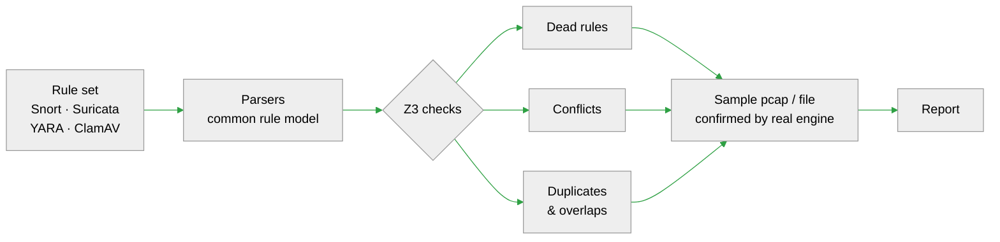
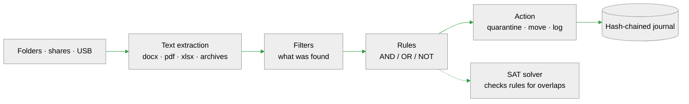
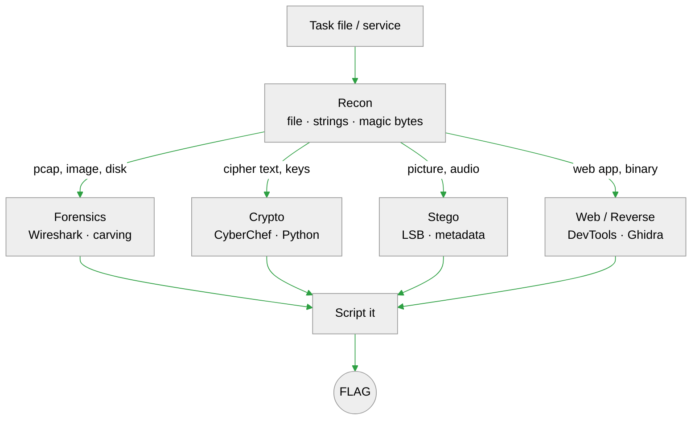

<!-- the header knows more than it shows -->
<p align="center">
<picture>
  <source media="(prefers-color-scheme: dark)" srcset="assets/header-dark.svg">
  <source media="(prefers-color-scheme: light)" srcset="assets/header-light.svg">
  
</picture>
</p>

<h3 align="center">Security Engineer · Pentester · CTF @ br34kcore · Tool builder</h3>

<p align="center">
  <a href="https://t.me/hazeker"></a>
</p>

```bash
$ xxd about.txt
00000000: 7365 6375 7269 7479 2065 6e67 696e 6565  security enginee
00000010: 7220 2620 746f 6f6c 2062 7569 6c64 6572  r & tool builder
00000020: 2e20 636f 6469 6e67 2073 696e 6365 2032  . coding since 2
00000030: 3032 322e 2049 2062 7265 616b 2074 6869  022. I break thi
00000040: 6e67 7320 746f 2073 6565 2068 6f77 2074  ngs to see how t
00000050: 6865 7920 776f 726b 2c20 7468 656e 2062  hey work, then b
00000060: 7569 6c64 2074 6f6f 6c73 2074 6861 7420  uild tools that 
00000070: 6361 7463 6820 7468 6520 7361 6d65 2062  catch the same b
00000080: 7567 7320 6175 746f 6d61 7469 6361 6c6c  ugs automaticall
00000090: 792e 2041 4920 6973 206d 7920 7061 6972  y. AI is my pair
000000a0: 2070 726f 6772 616d 6d65 723b 2074 6865   programmer; the
000000b0: 2064 6563 6973 696f 6e73 2061 6e64 2074   decisions and t
000000c0: 6865 2063 6865 636b 7320 6172 6520 6d69  he checks are mi
000000d0: 6e65 2e                                  ne.
```

<details>
<summary><code>decode</code></summary>

<div align="justify">
<p>
I've been writing code since 2022 and quickly ended up on the security side of it. What I enjoy most is
breaking things to understand how they work, and then building tools that find the same problems automatically.
</p>
<p>
Most of my projects sit where security meets formal methods: I use SAT/SMT solvers (Z3) to check
IDS rules, antivirus signatures and DLP policies for conflicts and dead rules before they reach production.
Next to that I build Telegram Mini Apps and small browser games, because shipping something people actually
play is the best way to learn.
</p>
<p>
I work with AI as a teammate. Claude helps me prototype, write tests, review code and dig through
unfamiliar formats, while I decide what to build, how it should work and verify every result.
AI lets me move faster; it doesn't replace understanding what the code does.
</p>
</div>

</details>

```bash
$ nmap -sV hazekerr
```

<picture>
  <source media="(prefers-color-scheme: dark)" srcset="assets/nmap-dark.svg">
  <source media="(prefers-color-scheme: light)" srcset="assets/nmap-light.svg">
  
</picture>

<details>
<summary><b>🎛️ Kamertone</b> &nbsp;<sub>in development · private</sub></summary>

Analyzer for IDS rules and antivirus signatures built on a SAT/SMT solver. It reads **Snort 3, Snort 2, Suricata, YARA and ClamAV** rule sets and, before the rules go live, finds:

- rules that can never fire;
- action conflicts: `pass` and `drop` on the same traffic, or `pass` taking traffic before another rule sees it;
- duplicates and rules fully covered by others;
- overlaps between rules with different actions, and differences between two versions of a rule set.

For every issue it builds a sample packet (pcap) or file and checks it with the **real engine** (Snort 3, Suricata, yara-python, ClamAV), so each finding says whether the engine confirmed it. Works offline, as a web app and as a CLI.



`Python` `Z3` `FastAPI` `PostgreSQL` `SQLAlchemy` `htmx` `Docker` `Caddy`

</details>

<details>
<summary><b>🔦 Echolot</b> &nbsp;<sub>v2.17 · private</sub></summary>

Desktop monitor that watches local folders, network shares and USB drives and looks for sensitive data inside files: personal data, passwords, card numbers, classification marks. Matching files are moved to quarantine or a protected folder by rules, and the rules themselves are checked for **overlaps with a SAT solver**.

- 16 built-in filters plus custom word lists and regular expressions
- reads Word, Excel, PDF, text, CSV, e-mail and archives (zip, 7z, rar)
- rules with AND / OR / NOT, dry-run mode, tamper-evident journal (SHA-256 hash chain)
- runs on Windows 7 and newer, 218 automated tests



`Python` `PyQt5` `Z3` `watchdog` `SQLite`

</details>

<details>
<summary><b>🐣 Popolam</b> &nbsp;<sub>Telegram Mini App · private</sub></summary>

A Telegram Mini App for couples: two people raise one shared pixel pet. Daily tasks keep the pet growing and a streak "flame" alive, and there are ten mini-games, a wardrobe and shop, achievements and a weekly tournament.

`JavaScript` `Node.js` `WebSocket` `PostgreSQL` `Supabase` `Render`

</details>

<details>
<summary><b>🍉 Watermelon on the Run</b> &nbsp;<sub><a href="https://hazekerr.github.io/watermelon-on-the-run/">play in browser</a> · <a href="https://github.com/hazekerr/watermelon-on-the-run">repo</a></sub></summary>

3D browser runner: a watermelon escapes the Astrakhan market with a knife-wielding vendor on its tail. Five zones, bosses, eight story endings, endless / rhythm / market-heist / Volga-boat modes, weather and day/night cycle. One HTML file on Three.js.

`JavaScript` `Three.js`

</details>

<details>
<summary><b>🔪 ctfknife</b> &nbsp;<sub><a href="https://github.com/hazekerr/ctfknife">repo</a></sub></summary>

Modular command-line toolkit for CTF. Plugins are discovered automatically: base64 / hex / binary / URL converter, Caesar and ROT, magic-byte detection, strings extraction and an LSB steganography decoder with auto-scan. Flags are highlighted in the output.

`Python` `rich` `Pillow`

</details>

```bash
$ cat ctf.md
```

I play CTF with team **br34kcore**. Events so far include **DUCKERZ CTF** and **SolarCTF**. My focus is forensics and steganography, and I'm moving into pentest and networks.

<details>
<summary><code>how it works</code></summary>



</details>

**Toolkit:** Kali Linux · Wireshark · CyberChef · Ghidra · Python · [ctfknife](https://github.com/hazekerr/ctfknife)

```bash
$ which --all tools
```

<p align="left"><b>Languages</b></p>


<p align="left"><b>Backend & data</b></p>


<p align="left"><b>Security & formal methods</b></p>


<p align="left"><b>Interfaces & graphics</b></p>


<p align="left"><b>AI & workflow</b></p>


```bash
$ cat now.md
```

- 🎛️ **Kamertone:** finishing the web interface and confirmation of findings by real engines
- 🐣 **Popolam:** new features for the shared pet and tournaments
- 🚩 **CTF:** playing with br34kcore, collecting forensics and stego tricks
- 📚 **Learning:** pentest, networks, forensics, steganography

```bash
$ git log --graph
```

<p align="center">
<picture>
  <source media="(prefers-color-scheme: dark)" srcset="https://raw.githubusercontent.com/hazekerr/hazekerr/output/snake-dark.svg">
  <source media="(prefers-color-scheme: light)" srcset="https://raw.githubusercontent.com/hazekerr/hazekerr/output/snake-light.svg">
  
</picture>
</p>

<p align="center">
<picture>
  <source media="(prefers-color-scheme: dark)" srcset="https://github-readme-activity-graph.vercel.app/graph?username=hazekerr&bg_color=0d1117&color=c9d1d9&line=3fb950&point=c9d1d9&area=true&area_color=3fb950&hide_border=true">
  <source media="(prefers-color-scheme: light)" srcset="https://github-readme-activity-graph.vercel.app/graph?username=hazekerr&bg_color=ffffff&color=1f2328&line=1a7f37&point=1f2328&area=true&area_color=1a7f37&hide_border=true">
  
</picture>
</p>

```bash
$ mpv --playlist on_repeat
```

🎧 Fortuna 812 · LSP · Plenka

<p align="center">
<picture>
  <source media="(prefers-color-scheme: dark)" srcset="assets/footer-dark.svg">
  <source media="(prefers-color-scheme: light)" srcset="assets/footer-light.svg">
  
</picture>
</p>
